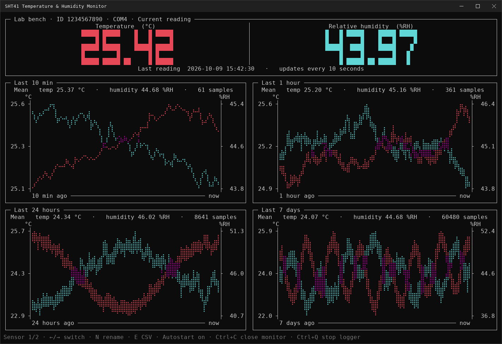

# SHT41 Terminal Monitor

A terminal dashboard and background logger for the Adafruit SHT41 Trinkey USB temperature and humidity sensor, on Windows desktops and Ubuntu servers (over SSH).



*Simulated readings, drawn by the monitor's own rendering code ([`tools/make_screenshot.py`](tools/make_screenshot.py)).*

## Features

- Current readout plus braille graphs of the last 10 min, 1 hour, 24 hours and 7 days, with separate °C and %RH axes.
- Logs every 10 s: raw samples are kept for 7 days, 5-minute mean/min/max indefinitely (SQLite).
- Several Trinkeys at once, one database per sensor ID; name sensors and switch with `←`/`→`.
- Survives unplugging: the monitor waits and logging resumes on reconnect (gaps stay gaps).
- The logger starts at Windows sign-in or Ubuntu boot (systemd) and outlives the monitor and SSH session.
- One-key export of a sensor's full history to an Excel-friendly CSV.

Requires an Adafruit SHT41 Trinkey with its factory firmware and a terminal of at least 120 × 42.

## Install and run

**Windows 10/11 x64** (no Python or internet needed)

1. Download the Windows ZIP from [Releases](https://github.com/iverydj/sht41-terminal-monitor/releases) and extract all of it to a writable folder (not Program Files).
2. Plug in the Trinkey(s) and run `SHT41 Monitor.exe`.

It starts the windowless `SHT41 Logger.exe` and registers it to run at sign-in (current user, no admin rights). To update, press `Ctrl+Q` in the old monitor and copy its `data` folder into the new one. Details and troubleshooting: the ZIP's `README.txt` ([source](distribution_readme.txt)).

**Ubuntu Server 26.04 LTS** (any CPU)

```sh
unzip SHT41_Monitor_Ubuntu_26.04_v2.1.0.zip
cd SHT41_Monitor_Ubuntu
sudo ./install.sh    # as a regular user with sudo, not from a root login
sht41-monitor
```

The installer fetches `python3` and `python3-serial` from the Ubuntu archive (internet needed) and enables `sht41-logger.service`, which keeps logging after you log out and across reboots. Operations and troubleshooting: [ubuntu/README.txt](ubuntu/README.txt).

## Keys

| Key | Action |
|---|---|
| `←` / `→` | Switch sensor |
| `N` | Rename the selected sensor |
| `E` | Export the selected sensor's history to CSV |
| `Ctrl+C` | Close the monitor (logging continues) |
| `Ctrl+Q` | Windows only: close the monitor and stop the logger for all sensors |

## Data

Each sensor has `data/sensor_<ID>/sht41_history.sqlite3` (next to the EXE on Windows, under `/var/lib/sht41-terminal-monitor/` on Ubuntu) with UTC Unix timestamps. CSV exports go to `exports/sensor_<ID>/SHT41_history_YYYYMMDD_HHMMSS.csv` with local time and UTC. A v1 single-file `data/sht41_history.sqlite3` is migrated automatically.

## From source

On Windows with Python 3.12+, run `setup.cmd` once, then `launch_monitor.cmd`. To use a fixed port instead of auto-detection, set `AppConfig.SERIAL_PORT` (e.g. `"COM4"`) at the top of `sht41_monitor.py`.

```sh
python -m unittest discover -s tests -v
python build_distribution.py          # Windows ZIP: 64-bit Windows + PyInstaller (requirements-dev.txt)
python build_ubuntu_distribution.py   # Ubuntu ZIP: standard library only
python tools/make_screenshot.py       # docs/screenshot.png: needs Pillow and DejaVu Sans Mono
```

## License

MIT, see [LICENSE](LICENSE).
